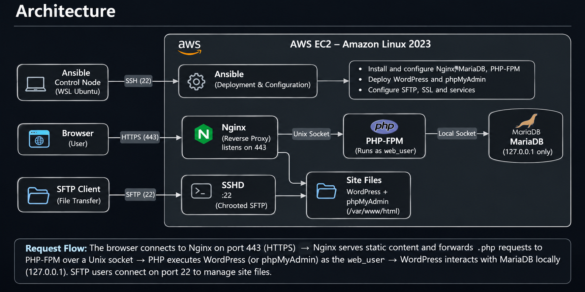
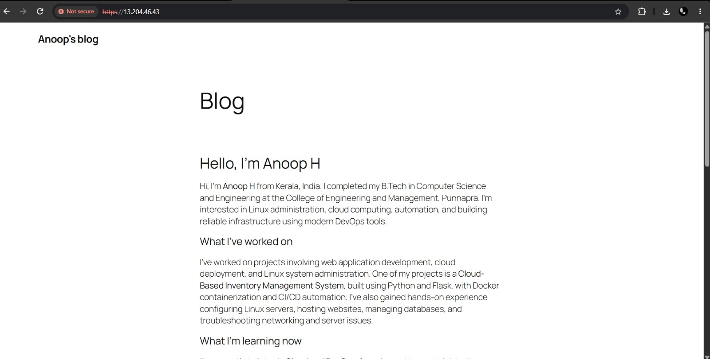

# Automated WordPress Deployment using Ansible

An infrastructure automation project that deploys and configures a WordPress website on an AWS EC2 instance running Amazon Linux 2023 using Ansible.

The project uses Ubuntu on WSL as the Ansible Control Node and an AWS EC2 instance as the Managed Node. It automates the installation and configuration of Nginx, MariaDB, PHP-FPM, WordPress, SFTP, phpMyAdmin, and HTTPS.

---

## Project Overview

The objective of this project is to automate the complete deployment of a WordPress website using Ansible.

Instead of manually installing and configuring individual services, Ansible playbooks and Jinja2 templates are used to automate server configuration, application deployment, and service management.

The deployment follows a Control Node–Managed Node architecture, where Ansible connects to the EC2 instance over SSH and executes the required configuration tasks.

## Architecture



### Architecture Components

**1. Ansible Control Node – Ubuntu on WSL**

The Ubuntu environment running on WSL acts as the Ansible Control Node. It contains Ansible, the inventory file, configuration variables, templates, and deployment playbook.

It communicates with the AWS EC2 instance over SSH on port 22 to execute deployment tasks.

**2. AWS EC2 – Amazon Linux 2023**

The EC2 instance acts as the Managed Node. It hosts the WordPress application and the supporting services installed and configured by Ansible.

**3. Nginx Web Server**

Nginx acts as the web server and handles incoming HTTP/HTTPS requests. HTTPS traffic is handled on port 443. Nginx serves static content directly and forwards PHP requests to PHP-FPM.

**4. PHP-FPM**

PHP-FPM processes PHP application requests from Nginx through a Unix socket. It executes WordPress and phpMyAdmin PHP scripts using the configured web user.

**5. MariaDB Database Server**

MariaDB stores WordPress data, including website settings, users, posts, and other application information. WordPress communicates with the database locally through the configured database connection.

**6. WordPress and phpMyAdmin**

WordPress provides the website and content management functionality. phpMyAdmin provides a browser-based interface for managing the MariaDB database.

**7. SFTP Access**

SFTP provides secure file transfer access to the configured website user over SSH port 22. The SFTP user is configured with restricted, chrooted access to the website files.

### Request and Deployment Flow

**Ansible Deployment Flow**

1. The administrator executes the Ansible playbook from Ubuntu on WSL.
2. Ansible reads the inventory and variable configuration files.
3. Ansible establishes an SSH connection to the EC2 instance.
4. The playbook installs and configures the required packages and services.
5. Jinja2 templates generate the required configuration files.
6. WordPress and phpMyAdmin are deployed and configured.
7. Ansible starts or restarts the required services.

**Website Request Flow**

1. A user accesses the website through a browser using HTTPS.
2. The request reaches Nginx on port 443.
3. Nginx serves static files directly and forwards PHP requests to PHP-FPM.
4. PHP-FPM executes the WordPress application.
5. WordPress communicates with MariaDB to retrieve or update website information.
6. The generated response is returned to the browser through Nginx.

**SFTP File Transfer Flow**

1. An SFTP client connects to the EC2 instance over SSH port 22.
2. The configured SFTP user authenticates.
3. The user receives restricted access to the designated website directory.
4. Website files can be uploaded, downloaded, and managed through SFTP.

---

## Technologies Used

| Category                | Technology        |
| ----------------------- | ----------------- |
| Cloud Platform          | AWS               |
| Compute Service         | Amazon EC2        |
| Operating System        | Amazon Linux 2023 |
| Control Node            | Ubuntu on WSL     |
| Automation              | Ansible           |
| Web Server              | Nginx             |
| Database                | MariaDB 10.6      |
| PHP Runtime             | PHP 8.2           |
| PHP Processing          | PHP-FPM           |
| CMS                     | WordPress         |
| Database Management     | phpMyAdmin        |
| File Transfer           | SFTP              |
| Configuration Templates | Jinja2            |
| Secure Access           | SSH               |
| Web Security            | HTTPS / SSL-TLS   |

## Project Features

- Automated WordPress deployment using Ansible.
- Nginx web server installation and configuration.
- MariaDB database installation and configuration.
- PHP and PHP-FPM configuration.
- Automated WordPress installation and database integration.
- phpMyAdmin deployment for database management.
- SFTP user creation with restricted access.
- HTTPS configuration using a self-signed SSL/TLS certificate.
- Service management and configuration through Ansible.
- Reusable configuration using Ansible variables and Jinja2 templates.

## Project Structure

```text
wordpress-ansible/
│
├── files/
│   └── blog-post.html
│
├── group_vars/
│   ├── all.example.yml
│   └── all.yml
│
├── inventory/
│   ├── hosts.example.ini
│   └── hosts.ini
│
├── templates/
│   ├── credentials.txt.j2
│   ├── mariadb-custom.cnf.j2
│   ├── mariadb.repo.j2
│   ├── nginx.conf.j2
│   ├── php-custom.ini.j2
│   ├── php-fpm-pool.conf.j2
│   ├── phpmyadmin-config.inc.php.j2
│   ├── site.conf.j2
│   └── wp-config.php.j2
│
├── screenshots/
│   ├── architecture.png
│   └── blog-homepage.png
│
├── .gitignore
├── ansible.cfg
├── README.md
└── site.yml
```

**Directory Description**

- `files/` – Contains static files copied to the managed server.
- `group_vars/` – Contains deployment variables and example configuration.
- `inventory/` – Defines the managed EC2 host and connection settings.
- `templates/` – Contains Jinja2 templates used to generate server and application configuration files.
- `screenshots/` – Contains project architecture and deployment screenshots.
- `ansible.cfg` – Defines Ansible configuration settings.
- `site.yml` – Main Ansible playbook containing the deployment tasks.
- `.gitignore` – Excludes private configuration files and sensitive data from Git.

**Note:** `all.yml` and `hosts.ini` are local private configuration files. They should not be committed to the public repository. Use the example files when setting up your own deployment.

## Prerequisites

Before running this project, ensure that you have:

- An AWS account.
- An Amazon Linux 2023 EC2 instance.
- An SSH key pair for EC2 access.
- Ubuntu on WSL or another supported Linux environment.
- Ansible installed on the Control Node.
- SSH connectivity between the Control Node and EC2 instance.
- Appropriate EC2 security group rules.

Required network access:

| Port | Protocol | Purpose                                   |
| ---- | -------- | ----------------------------------------- |
| 22   | SSH      | Ansible connection and SFTP               |
| 443  | HTTPS    | Secure website access                     |
| 80   | HTTP     | HTTP access or redirection, if configured |

## Configuration

Clone the repository:

```bash
git clone https://github.com/Anoop71792/wordpress-deployment-ansible.git
cd wordpress-deployment-ansible
```

Create local configuration files from the provided examples:

```bash
cp inventory/hosts.example.ini inventory/hosts.ini
cp group_vars/all.example.yml group_vars/all.yml
```

### 1. Inventory Configuration

Edit `inventory/hosts.ini` and configure:

- EC2 public IP address.
- SSH username.
- SSH private key path.

Example:

```ini
[webservers]
ec2 ansible_host=YOUR_EC2_PUBLIC_IP ansible_user=ec2-user ansible_ssh_private_key_file=~/.ssh/YOUR_KEY.pem
```

### 2. Variable Configuration

Edit `group_vars/all.yml` and configure the required values:

- SFTP username and password.
- Database name, username, and password.
- phpMyAdmin authentication credentials.
- WordPress administrator username and password.
- WordPress website title and tagline.
- Administrator email address.
- Other application and server configuration variables.

Replace all example passwords with strong, unique credentials before deployment.

## Deployment

### Step 1: Verify Ansible Connectivity

Test the connection between the Control Node and Managed Node:

```bash
ansible webservers -m ping
```

A successful connection returns:

```text
ec2 | SUCCESS => {
    "changed": false,
    "ping": "pong"
}
```

### Step 2: Execute the Playbook

Run the main Ansible playbook:

```bash
ansible-playbook site.yml
```

Ansible executes the configured tasks on the EC2 instance and deploys the required services.

### Step 3: Review Deployment Results

After execution, review the Ansible play recap to confirm that the deployment completed without failed or unreachable tasks.

## Verification

After deployment, verify the following components:

| Component  | Verification                            |
| ---------- | --------------------------------------- |
| Nginx      | Confirm the service is active           |
| MariaDB    | Confirm the database service is running |
| PHP-FPM    | Confirm the PHP-FPM service is active   |
| WordPress  | Open the website in a browser           |
| Database   | Verify WordPress database connectivity  |
| SFTP       | Test login using an SFTP client         |
| phpMyAdmin | Open the configured phpMyAdmin URL      |
| HTTPS      | Test secure website access              |

## Example Deployed WordPress Blog

The following screenshot shows the example WordPress blog page deployed through the Ansible automation project.



The example page contains:

- Custom blog title.
- Personal introduction.
- Project and technical experience.
- Cloud and DevOps learning information.
- WordPress content displayed through the deployed web server.

## Security Considerations

- Never commit private SSH keys or actual passwords.
- Keep `group_vars/all.yml` and `inventory/hosts.ini` excluded from Git.
- Use Ansible Vault to encrypt sensitive variables.
- Use strong and unique passwords for database, SFTP, phpMyAdmin, and WordPress accounts.
- Restrict EC2 security group rules to trusted sources wherever possible.
- The project uses a self-signed SSL/TLS certificate for demonstration. Browsers may display a certificate warning.
- Use a trusted SSL/TLS certificate for production environments.
- Review generated credential files and logs before sharing project screenshots or reports.

## Author

**Anoop H**

Cloud and DevOps

## License

This project is intended for educational and demonstration purposes. Additional security hardening and production configuration may be required before using it in a live environment.
